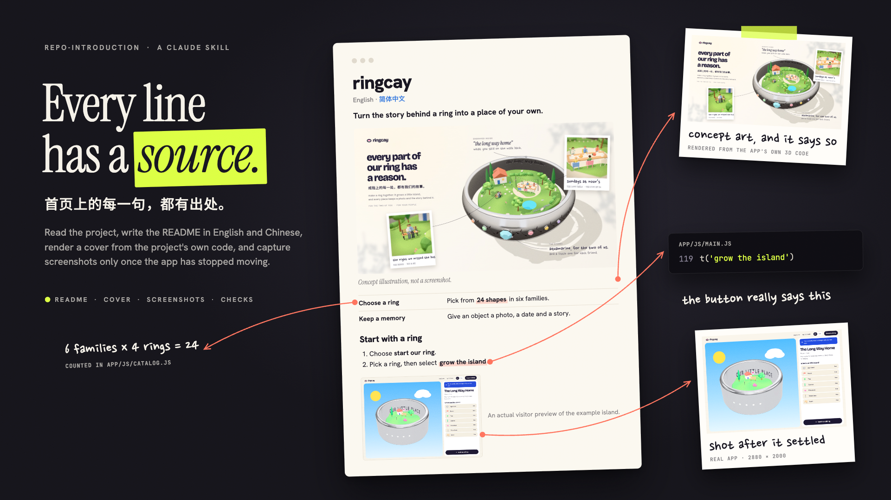

# repo-introduction

[English](README.md) · 简体中文 · [安装](docs/INSTALL.md) · [完整案例](examples/ringcay.md)

**把一个真实项目，做成陌生人一看就懂的 GitHub 首页：中英文 README、用项目自己做出来的封面、真实截图，每一句都对照代码核实过。**



*概念插图，用本 skill 自带的封面模板制作。图中的页面和截图来自 [ringcay](https://github.com/Cynthiawongss/ringcay)。*

这是一个给 Claude 用的 skill，其他能读取 `SKILL.md` 的智能体也能用。你让它写、审或者重做一个项目的介绍，它会先读代码，再写中英文 README、做封面和截图、逐项检查。只有你说了要发布，它才会发布。

## 和通常的做法有什么不同

| 通常的结果 | 用这个 skill |
|---|---|
| 一串功能列表 | 先讲用户得到什么，再给一个在真实产品里做出来的具体例子 |
| 按钮名和数字凭记忆写 | 每个粗体按钮名和数量都在源码里找到（`check_readme.py --source`） |
| AI 生成的封面，越画越不像产品 | 用项目自己的代码渲染，或用真实素材排版，文字是真正的字体 |
| 截图随手一截 | 用脚本在页面停止变化后再截，视口固定，语言和 README 一致 |
| 一次给六张图让你挑 | 一次一张编号候选，助手先自己审过；你提的意见只改你说的那一处 |
| "已发布！" | 推送后核对线上 README、图片链接、About 和 Pages |

## 例子：ringcay

[ringcay](https://github.com/Cynthiawongss/ringcay) 是一个网页原型：一枚戒指长成一座 3D 小岛，岛上装着情侣或朋友的回忆。之前 AI 生成的封面都没通过：太可爱、太灰，或者不贴题。

| 步骤 | 做了什么 |
|---|---|
| 理解需求 | 读交接文档和主人的原话：情侣和朋友、白天、温馨、成熟不幼稚；保留"戒指里有一个世界"的核心 |
| 封面 | 用网站自己的 Three.js 戒指和小岛代码渲染。引线把长椅、长桌、内圈刻字和宝石分别连到它们的故事 |
| 自审 | 给用户看候选 01 之前，先自己渲染、看图、修改了好几轮，并且把还存在的弱点一起告诉用户 |
| 反馈 | "戒圈有点素。"只改戒圈：一颗海蓝宝、五颗小彩石、藤蔓刻纹、珠边。通过 |
| README | 保留原有草稿，先对照代码核实按钮名和数字；换掉没通过的旧封面，删掉一张在动画中途截的截图 |
| 发布 | 先合并 GitHub 上新增的两个提交，再推送，并核对线上 README 和图片 |

[看完整案例 →](examples/ringcay.md)

## 安装

**Claude Code：** 把 skill 文件夹复制到 skills 目录。

```sh
git clone https://github.com/Cynthiawongss/repo-introduction.git
cp -R repo-introduction/skills/repo-introduction ~/.claude/skills/
```

**Claude 应用：** 在[最新发布页](https://github.com/Cynthiawongss/repo-introduction/releases/latest)下载 `repo-introduction-skill.zip`，然后在 设置 → Capabilities → Skills 里上传。

其他宿主和更新方法见 [docs/INSTALL.md](docs/INSTALL.md)。

## 怎么用

直接用自然语言说：

> 给这个项目写 README，中英文，加一张封面和两张截图。先别发布。

> 这份 README 是 Codex 写的，写得好吗？有问题就改，然后推上去。

也可以点名调用：`/repo-introduction`。

## 里面有什么

| 路径 | 用途 |
|---|---|
| [`SKILL.md`](skills/repo-introduction/SKILL.md) | 工作流程：定范围 → 读项目 → 写 → 做图 → 整理 → 检查 → 发布 → 汇报 |
| [`references/visuals.md`](skills/repo-introduction/references/visuals.md) | 封面和截图怎么做、怎么自审 |
| [`references/method.md`](skills/repo-introduction/references/method.md) | 定位、页面结构、例子、双语写法 |
| [`references/readme-review.md`](skills/repo-introduction/references/readme-review.md) | 用产品经理的角度审一份 README |
| [`templates/cover.html`](skills/repo-introduction/templates/cover.html) | 1920×1080 编辑排版封面模板，自动计算引线，带颗粒质感 |
| [`scripts/shoot.mjs`](skills/repo-introduction/scripts/shoot.mjs) | 调用本机 Chrome 截图、导出封面 |
| [`scripts/check_readme.py`](skills/repo-introduction/scripts/check_readme.py) | 检查链接、图片、本机路径、中英文一致性、按钮名是否在源码里 |

## 环境要求和限制

- 脚本需要 **Node 22+** 和本机的 **Chrome、Chromium、Edge 或 Brave**（`shoot.mjs`），以及 **Python 3**（`check_readme.py`）。不用装任何依赖包。
- 封面模板的字体从 Google Fonts 加载，所以渲染时需要联网。
- `check_readme.py` 只能找机械性问题，判断不了文案好不好、封面贴不贴题。
- 目前在两个项目上用过：ringcay（封面、审 README、发布）和本仓库（封面、README、检查）。`shoot.mjs` 只在 macOS 的 Chrome 上测试过。
- 主人偏好文件只代表一个人的审美。自己用的话可以修改或删掉。
- AI 生图是可选项，用之前一定先问；本 skill 不附带任何生图模型。

## 来源和许可证

这套方法最早来自用 Codex 给五个 skill 仓库写介绍时整理的交接包，后来在用 Claude 完成 ringcay 的封面和 README 之后重写。MIT 许可证，见 [LICENSE](LICENSE)。
